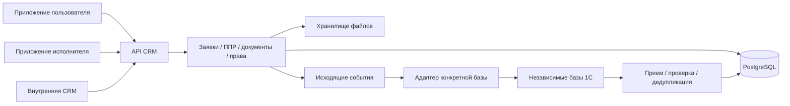

# Рабочее ТЗ: эксплуатация недвижимости и обмен с 1С

Источник: `2_5309922712913749870.docx`, версия 1.0, сентябрь 2026. Разобраны текст, таблицы и три схемы. Срез репозитория для оценки: `cfa8b52`, 30.09.2026. Это уточнение исходного ТЗ для разработки; предположения ниже не являются согласованными правилами бизнеса.

## 1. Что строим

1С — источник учетных данных. CRM — источник операционных данных. Пользовательские приложения обращаются только к API CRM, а обмен с каждой базой 1С выполняется отдельным адаптером.

Нужны три продукта: внутренняя CRM; приложение собственника/арендатора; приложение исполнителя. Для каждого мобильного продукта нужны Android и iOS, то есть четыре платформенные сборки. Общие контракты и компоненты допустимы, разные приложения не должны быть просто двумя названиями одной общей сборки с административным меню. Отдельный публичный web-кабинет в MVP не требуется.

Сквозной результат MVP: человек входит по телефону, выбирает разрешенное помещение/ЛС, подает заявку; диспетчер классифицирует ее; платную работу предварительно согласуют; исполнитель выполняет задание с фото и чек-листом; уполномоченный участник принимает результат. Инженер ведет ППР. Пользователь передает показания, инженер проверяет, 1С принимает данные и возвращает учетные результаты.

## 2. Границы ответственности

| Данные                                        | Кто ведет                                                         | Что делает CRM                                                                                          |
| --------------------------------------------- | ----------------------------------------------------------------- | ------------------------------------------------------------------------------------------------------- |
| Контрагенты, помещения, договоры, ЛС, приборы | Назначенная база 1С; точный мастер каждого справочника уточняется | Хранит проекцию, внешние идентификаторы и связи для эксплуатации                                        |
| Начисления, оплаты, задолженность             | 1С                                                                | Отображает полученные суммы, детализацию и дату синхронизации; не пересчитывает бухгалтерский результат |
| Заявки, согласования, фото, задания, ППР      | CRM                                                               | Ведет весь процесс и историю; передает учетные результаты при необходимости                             |
| Переданные показания                          | CRM до проверки, далее обмен с 1С                                 | Проверяет ввод, направляет инженеру, хранит статус доставки и ответ 1С                                  |
| Права человека на конкретные сущности         | CRM на основании учетных связей и ручных назначений               | Проверяет действие, область, срок действия и аудит изменения                                            |

Существующие локальные счета, оплаты, тарифы и распределение коммунальных сумм нельзя внезапно удалить: в них есть данные. Для подключаемого к 1С объекта сначала сопоставляются записи, затем фиксируется источник учета и запрещается параллельное ручное изменение учетных сумм. Неподключенные объекты продолжают существующий режим до отдельного перехода. Это управляемая миграция данных, а не запасной расчет при недоступности 1С.

## 3. Нормализованные требования

| ID     | Требование                         | Проверяемый результат                                                                                                                                  |
| ------ | ---------------------------------- | ------------------------------------------------------------------------------------------------------------------------------------------------------ |
| ARC-01 | Разделить учет и эксплуатацию      | CRM не начисляет суммы за базу 1С; клиенты не содержат ее адресов и секретов                                                                           |
| INT-01 | Несколько независимых источников   | Ключ внешней записи: источник + тип сущности + внешний ID; совпавшие ID двух баз не смешиваются                                                        |
| INT-02 | Надежный обмен                     | Inbox/outbox, идемпотентность, версии/порядок, попытки, ошибки, ручной повтор; повтор сообщения не создает дубль                                       |
| INT-03 | Контроль среды                     | Источник принадлежит test или production; тестовый пакет нельзя применить в промышленном контуре                                                       |
| ACC-01 | Множественные связи человека       | Отдельная запись user + роль + область + период; один человек может быть собственником в одном помещении и арендатором в другом                        |
| ACC-02 | Доступ к финансам через договор/ЛС | Знание ID помещения и общее право просмотра не открывают чужой договор, платеж или документ                                                            |
| ACC-03 | Независимые действия               | Ввод показаний, просмотр начислений, согласование платной работы и управление пользователями назначаются отдельно                                      |
| ACC-04 | Окончание договора и ручные связи  | Новые действия арендатора блокируются после срока; ручная корректировка имеет автора/причину; политика истории согласуется отдельно                    |
| MOB-01 | Два мобильных продукта             | Отдельные приложения пользователя и исполнителя, Android/iOS, проверка на физических устройствах, камера, файлы, уведомления, жизненный цикл сессии    |
| TKT-01 | Полный цикл                        | Регистрация → классификация → согласование при необходимости → назначение → работа → ожидание подтверждения → принятие → закрытие                      |
| TKT-02 | Платное согласование               | До начала исполнения есть действительное решение уполномоченного лица по конкретной версии стоимости/условий; изменение условий требует нового решения |
| TKT-03 | Исполнение и приемка               | Фото до/после и обязательные пункты проверяются сервером; возврат, отказ от выполнения и приостановка требуют причины                                  |
| TKT-04 | Диспетчеризация и история          | Назначение исполнителя/службы, SLA, поиск архива, история статуса/срока/исполнителя, повторные обращения                                               |
| PPR-01 | Регламенты и календарь             | Повторяемый график создает задания без дублей; изменение плана не изменяет выданный чек-лист                                                           |
| PPR-02 | Импорт Excel/CSV                   | Предпросмотр ошибок и неоднозначных связей; импорт проверенных строк; повтор не создает дублей; дальнейшая правка в CRM                                |
| PPR-03 | План/факт                          | Выполненные, просроченные и перенесенные задания, причина переноса, технические замечания и история оборудования                                       |
| MTR-01 | Подача и проверка показаний        | Открытый период, право на прибор/ЛС, фото, предыдущее значение, аномалии, решение инженера                                                             |
| MTR-02 | Передача в учет                    | Только принятые показания отправляются в выбранную 1С; пользователь видит принято/на проверке/отклонено, оператор — доставку                           |
| FIN-01 | Финансовая витрина                 | ЛС отдельно от договора, начисления по услугам/периодам, оплаты/долг и дата обновления из 1С                                                           |
| DOC-01 | Единые документы                   | Файл или разрешенная корпоративная ссылка связаны с объектом, помещением, оборудованием, договором/ЛС, заявкой/ППР; проверяется право на эту связь     |
| NTF-01 | Уведомления                        | Участники получают события по разрешенным процессам; мобильная доставка и повторные попытки проверены                                                  |
| AUD-01 | История и аудит                    | Изменения связей, прав и бизнес-сущностей сохраняют автора, время, до/после и корреляцию; секреты не попадают в журнал                                 |
| OPS-01 | Эксплуатация                       | Миграции заполненной БД, резервное копирование/восстановление, мониторинг очередей/обмена, инструкция администратора                                   |

На схеме заявки «выполнена» расположена после подтверждения. В текущей реализации `completed` уже считается завершенным статусом. Новую приемку необходимо проектировать явно и мигрировать старые статусы, а не переименовывать кнопки, оставив старые переходы API.

## 4. Что фактически есть

«Есть» ниже означает реализованный проверяемый механизм, а не приемку целевого MVP на данных заказчика.

| Область / ID                             | Оценка                               | Подтверждение в коде                                                                                          | Остаток                                                                                                                                            |
| ---------------------------------------- | ------------------------------------ | ------------------------------------------------------------------------------------------------------------- | -------------------------------------------------------------------------------------------------------------------------------------------------- |
| Внутренняя CRM                           | Есть основа                          | `apps/web/src/features/shell`, `features/tickets`, `features/operations`                                      | Отдельные рабочие процессы диспетчера/инженера, область доступа по назначениям                                                                     |
| Иерархия объектов                        | Есть                                 | `domain/structure.js`, миграция 003, `StructureWorkspace.tsx`                                                 | Внешняя идентификация по источникам 1С, юридические лица, сопоставление                                                                            |
| Объекты/помещения одного контрагента     | Частично                             | `services/queries/workspace.js`, `queries/tenant.js`                                                          | У пользователя один `tenant_id`, у сотрудника один `property_id`; это не произвольные множественные назначения                                     |
| ACC-01–04                                | Требует переработки                  | `permissions.ts`, `services/access.js`, `operationsScope()`                                                   | Нет собственника, ЛС и назначений с периодом; права ограничены шаблоном глобальной роли. Проверки срока договора неодинаковы между маршрутами      |
| Вход по телефону                         | Частично                             | `routes/auth.js`, `bot-links.js`, `services/bots`                                                             | Есть OTP через привязанные мессенджеры; нет универсальной учетной связи по подтвержденному телефону из нескольких 1С                               |
| Заявки, назначение, комментарии, файлы   | Есть основа                          | `database/tickets.js`, `routes/tickets.js`, `features/tickets`                                                | Приемка результата, службы/группы, причины невозможности выполнения, правила обязательных фото и эскалаций                                         |
| TKT-02                                   | Частично                             | `domain/estimates.js`, `features/platform/Estimates.tsx`                                                      | Согласование сметы сотрудником не блокирует старт платной заявки и не означает согласование собственником/арендатором по ЛС                        |
| PPR-01                                   | Есть                                 | `domain/maintenance.js`, `operations.js`, `OperationEditor.tsx`, `tests/platform.test.mjs`                    | Пилот на реальных регламентах и уточнение сроков/служб                                                                                             |
| PPR-02                                   | Реализован первый блок 30.09.2026    | `services/maintenance-import.js`, `maintenance-sheet.js`, `MaintenanceImport.tsx`, миграция 004               | CSV/XLSX по явным колонкам, предпросмотр, проверка неоднозначностей и повторов; адаптация календарной матрицы требует реального файла              |
| PPR-03                                   | Частично                             | `agenda.js`, `OperationCard.tsx`, связь задания с ППР/оборудованием                                           | Перенос отдельного задания с причиной, отчет план/факт и замечания; не переносить график задним числом                                             |
| MTR-01–02                                | Частично, учетный поток иной         | `operations.js:addReading`, `routes/billing.js`, `WorkerMeters.tsx`                                           | Есть ввод/проверка уменьшения и локальное распределение по тарифу. Нет инженерной проверки, периодов приема, очереди обмена, финансовых прав по ЛС |
| FIN-01                                   | Новая модель и миграция              | `database/billing.js`, `queries/finance.js`, `ManagerBilling.tsx`                                             | Сейчас счета/оплаты создаются в CRM, привязаны к договору. Отдельного ЛС и проекции 1С нет                                                         |
| INT-01–03                                | Требует реализации                   | В `routes/system.js` integrations — Telegram/VK; общего адаптера 1С нет                                       | Источники, внешние ключи, inbox/outbox, дедупликация, журнал, сопоставление, адаптер конкретной конфигурации                                       |
| DOC-01                                   | Частично                             | `file-storage.js`, `services/documents.js`, вложения заявок и договоров                                       | Документы объекта/строения/оборудования/ЛС, единый реестр и новая модель прав                                                                      |
| MOB-01                                   | Требует реализации продуктов         | `apps/android` — одна Capacitor-оболочка общего web; `features/tenant`, `features/worker` — браузерные экраны | Два независимых приложения, iOS-проекты, подписи/публикация, push, камера, испытания устройств; наличие web-экрана не означает готовое приложение  |
| NTF-01                                   | Частично                             | `services/notifications.js`, `delivery.js`, `bots`                                                            | Есть in-app и каналы ботов; нет подтвержденного APNs/FCM для двух приложений                                                                       |
| AUD-01                                   | Есть основа                          | `persistence/audit.js`, `persistence/database.js`, append-only триггеры, `AuditLog.tsx`                       | Распространить на будущие назначения/ЛС/обмен; добавить удобные бизнес-фильтры и сроки хранения                                                    |
| OPS-01                                   | Есть основа                          | `infra/deploy`, `tests/postgres`, `tests/browser.mjs`                                                         | Приемка восстановления и новой миграции учетных данных, наблюдаемость обмена, мобильная матрица устройств                                          |
| Передача помещения                       | Следующий этап                       | Документы и заявки можно повторно использовать                                                                | Обходы, дефекты, повторная приемка, ключи, акт передачи — отдельного процесса нет                                                                  |
| CAD, сметы/материалы, финансовый прогноз | Сделано сверх приоритетов нового MVP | `features/platform/plans`, `domain/cad.js`, `Estimates.tsx`, `ForecastChart.tsx`                              | Сохранить работающие функции; не расширять в ущерб 1С, доступу и мобильным сценариям                                                               |

Основные риски: доступ к финансам через слишком широкую связь с контрагентом; параллельные источники финансовых сумм; смешение идентификаторов разных 1С; завершение заявки без независимой приемки. Общий импорт использует поиск по текстовым названиям, поэтому для ППР его нельзя просто включить без проверки неоднозначности и повторов.

## 5. Целевая модель и контракты

Предлагаемые сущности для последующего этапа (пока не реализованные таблицы):

- `accounting_sources`: код, среда, конфигурация, состояние подключения; секреты отдельно от бизнес-записи.
- `external_references`: sourceId + entityType + externalId → localId, внешняя версия. Никакого автоматического объединения по совпавшему названию/телефону.
- `personal_accounts`: sourceId, внешний ID, договор, номер, период действия, статус. Номер ЛС не уникален между базами.
- `user_assignments`: userId, businessRole, scopeType/scopeId, permissions, validFrom/validTo, origin, основание и автор изменения. Области: объект, помещение, договор, ЛС. Роль собственника не дает автоматически доступ к финансам арендатора.
- `exchange_inbox` / `exchange_outbox`: sourceId, messageId, schemaVersion, entityVersion, payloadHash, status, attempts, nextAttemptAt, error, correlationId. Обработка входящего пакета атомарна; повтор с тем же ID и другим содержимым — конфликт.
- `reading_submissions`: прибор/ЛС, период, значение, фото, проверка инженера и отдельное состояние отправки в 1С.
- `ticket_approvals` / `ticket_acceptances`: решение, полномочие, версия согласованных условий/результата, автор, дата, причина возврата.

Транспорт и имена реквизитов 1С не выдумываются: нужны конфигурация, версия, тестовая база/выгрузка и доступный способ обмена. Нейтральные DTO CRM версионируются независимо от реквизитов конкретной базы.

## 6. План работ и зависимостей

| Этап | Действия                                                                               | Зависимости                                                         | Размер | Критерий выхода / статус                                                                                                                                        |
| ---- | -------------------------------------------------------------------------------------- | ------------------------------------------------------------------- | ------ | --------------------------------------------------------------------------------------------------------------------------------------------------------------- |
| 0    | Разбор ТЗ, сверка кода, границы учета, реестр вопросов                                 | Исходный документ и репозиторий                                     | S      | Этот документ; выполнено                                                                                                                                        |
| 1A   | Обследовать базы 1С и подготовить пробный пакет                                        | Конфигурации, тестовые данные, контакт ответственного за 1С         | M      | Один источник, объект, договор, ЛС и пользователь проходят сопоставление; ожидаются вводные                                                                     |
| 1B   | Импорт графика ППР с предпросмотром, строгими связями и защитой повторов               | Существующий ППР; реальный Excel желателен для настройки колонок    | M      | Реализовано и проверено: CSV/XLSX, предпросмотр, атомарность, повтор, конкурентная загрузка, сохранение правок/истории. Реальный файл заказчика еще не проверен |
| 2    | Источники учета, внешние ссылки, ЛС, миграция связей, нейтральные DTO                  | Модель этапа 0; реальные сопоставления из 1A перед переходом данных | L      | Две базы с одинаковыми внешними ID не смешиваются; миграция сохраняет ссылки/историю                                                                            |
| 3    | Контекстные назначения пользователя, финансовые permissions, сроки доступа             | 2, согласованная матрица                                            | L      | Собственник и арендатор одного помещения видят разные ЛС; окончание договора блокирует новые действия на всех маршрутах и в ботах                               |
| 4    | Inbox/outbox, адаптер 1С, экран ошибок/повторов, финансовая витрина                    | 1A, 2, 3                                                            | L      | Повтор/перестановка/сбой пакета не создают дублей; учетные суммы только из источника                                                                            |
| 5    | Платное согласование, обязательные фото, приемка/возврат, службы, причины переноса ППР | 3; существующие заявки и ППР                                        | L      | Полный сценарий заявки нельзя обойти прямым API; история сохраняется                                                                                            |
| 6    | Документы по всем типам сущностей; инженерная проверка показаний и обмен               | 3, 4                                                                | L      | Пользователь подает показание с фото; инженер принимает; пакет подтвержден 1С; чужой файл недоступен                                                            |
| 7    | Два мобильных продукта Android/iOS, камера, push, безопасные сессии                    | Устойчивые DTO 3–6; аккаунты публикации, macOS/Xcode для iOS        | L      | Четыре подписанные сборки; проверка на устройствах и сценариях плохой связи                                                                                     |
| 8    | Пилот, импорт исходных данных, восстановление, нагрузка и инструкции                   | 1–7                                                                 | M/L    | Сценарии раздела 7 пройдены на ограниченном наборе реальных строений/пользователей                                                                              |

S/M/L — относительный размер, не обещание календарного срока. Срок интеграции и мобильного выпуска без обследования 1С и доступов к сборке оценивать достоверно нельзя. Подготовку мобильных оболочек можно вести после фиксации DTO, но публикацию нельзя считать завершенной по одной локальной web-сборке.

## 7. Приемка MVP

1. Один человек имеет минимум два назначения с разными ролями и сроками; перебор ID через API не открывает чужие ЛС/файлы.
2. Одно помещение имеет собственника и арендатора с разными финансовыми правами; отзыв назначения действует в существующей сессии.
3. Бесплатная заявка проходит исполнение с обязательными фото и независимую приемку, затем закрытие/возврат.
4. Платная заявка не стартует без согласия уполномоченного лица; изменение стоимости аннулирует старое согласование.
5. ППР импортируется с отчетом неоднозначностей, генерирует задания без дублей, перенос фиксирует причину, история переживает правки плана.
6. Показание проходит формат/период/аномалии, проверку инженера и подтвержденную отправку; повтор доставки безопасен.
7. Две тестовые 1С с одинаковыми ID не пересекаются; ошибки видны, повтор после исправления работает, production не принимает тестовые пакеты.
8. Начисления в приложении совпадают с выгрузкой 1С, видны дата обновления и ошибки синхронизации.
9. Документы и фото доступны ровно разрешенным участникам; изменения прав/связей присутствуют в аудите.
10. Оба приложения проходят сценарии Android/iOS: камера, возврат из фона, истечение сессии, потеря сети и уведомление о задании.
11. Резервная копия восстанавливается, миграция заполненной БД сохраняет учетные и операционные связи.

## 8. Вопросы, влияющие на реализацию

- Какие конфигурации/версии и базы 1С участвуют? Какая обслуживает каждое юридическое лицо/площадку? Доступны ли тестовая база и обезличенные выгрузки?
- Как создаются ЛС по типам договоров? Может ли договор иметь несколько ЛС? Как связываются общедомовые приборы?
- Кто видит начисления собственника и арендатора, кто согласует платную работу и передает показания? Что остается доступным после окончания договора?
- Какие виды работ требуют фото до/после, кто принимает результат, какие сроки/службы/эскалации используются?
- Каков формат реального Excel ППР: строки регламентов или календарная матрица? Есть ли устойчивые коды оборудования/графиков?
- Где мастер приборов и кто проверяет аномалии? Как задается период ввода?
- Какие корпоративные хранилища, push/платежи/ЭДО нужны именно в MVP? Кто владеет учетными записями Apple/Google и ключами сборки?

До ответа не предполагаем права собственника на финансы арендатора, доступ ко всем помещениям одного контрагента или готовый HTTP API любой 1С. Работы без этих зависимостей продолжаются.

## 9. Выполнено в первой итерации

- Зафиксированы границы учета и эксплуатации, 23 проверяемых требования, оценка текущего кода, порядок зависимостей и вопросы к 1С.
- Реализован этап 1B: форма импорта ППР, шаблон XLSX, CSV с экранированием/переносами, даты Excel, проверка неоднозначных связей и прав, применение всего файла одной транзакцией.
- Код графика сохраняется после ручных правок. Повтор не создает дубликаты и не изменяет выданные задания; два одновременных применения одного предпросмотра не создают две записи.
- Добавлены модульные, HTTP, PostgreSQL и браузерные проверки. Миграция проверяется на заполненном предыдущем состоянии БД.
- Не объявлены готовыми обмен с 1С, ЛС, контекстные назначения и два мобильных продукта. Следующая независимая очередь разработки — этап 2: источники, внешние ссылки и ЛС; реальный адаптер зависит от ответов по 1С.
