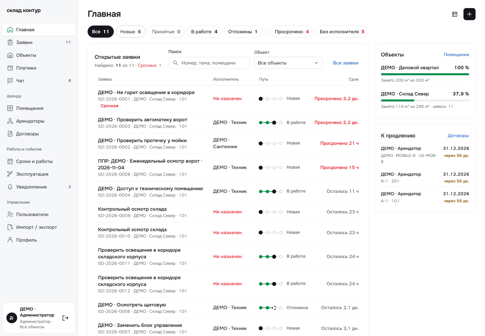
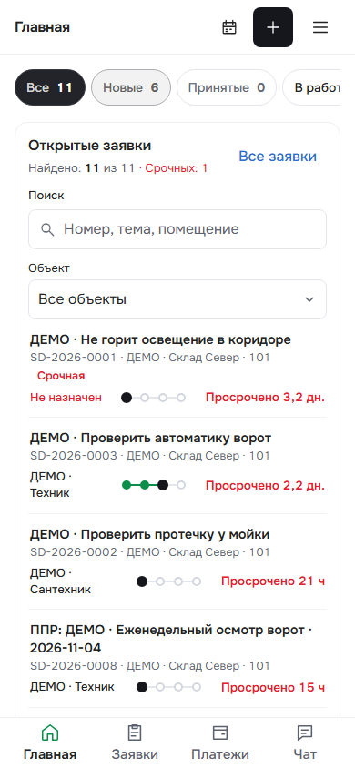
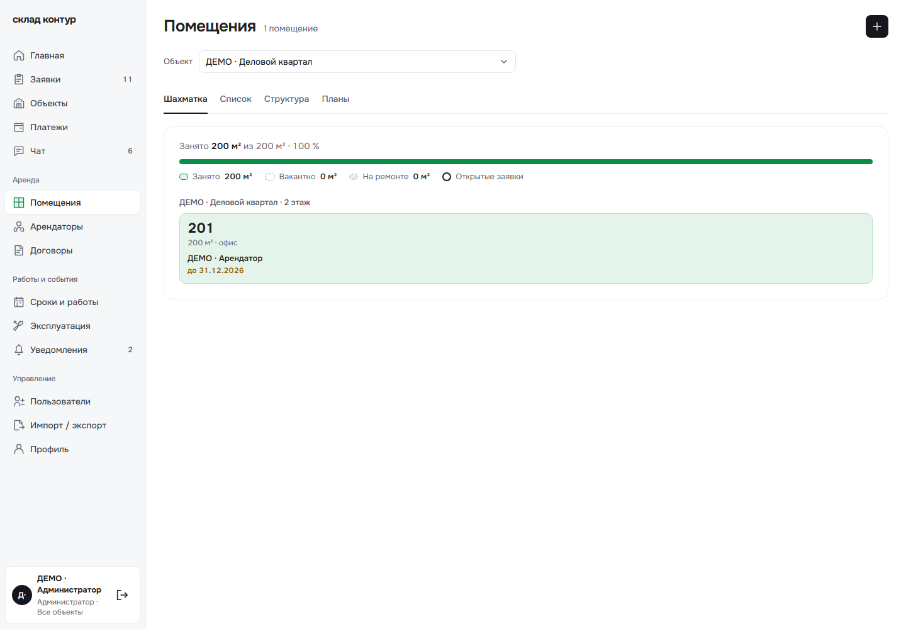
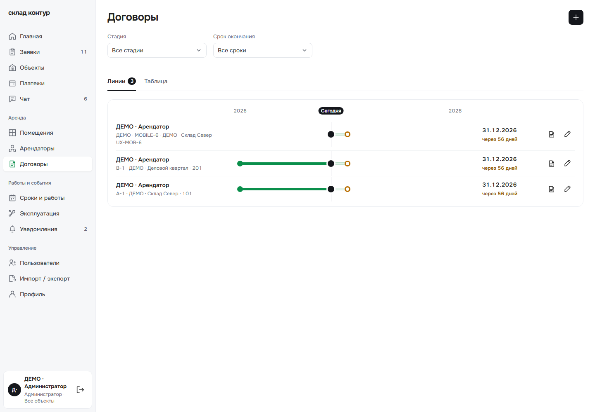
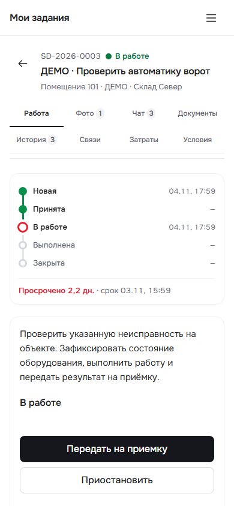
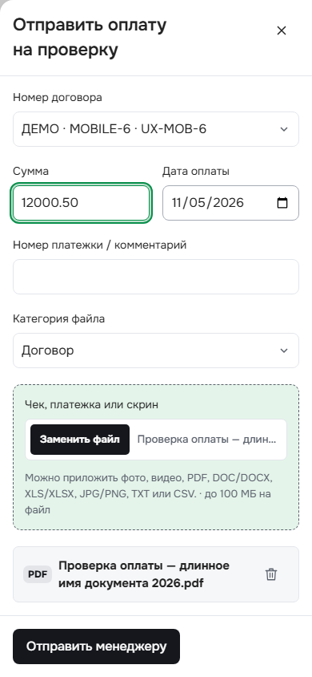

# «Линия метро»: проверки и публикация

В Wirehouse перенесены оба коммита дизайна из [design/signal-pilot](https://github.com/klis192/pp_design_v1/tree/design/signal-pilot): `c1f6ac3` и `066fc05`. Они продолжают опубликованный `c3aff43`; история исходной ветки сохранена. Публикация относится к существующему сайту «Склад Контур».

Новый общий стиль включает Onest Variable с локальной загрузкой, графитовые действия, статусы в виде станций, обновлённые формы, вкладки и навигацию. На главной появились переключатели статусов и сводка объектов; у помещений — шахматка, у договоров — линии сроков, у заявки — путь по истории. Прежние список, таблица, структура, DXF-планы, документы и бизнес-действия доступны в своих разделах. Иконка рядом с названием продукта не возвращалась.

Перед выпуском исправлены три найденные проблемы:

- Отказ до начала работы и пауза после возврата из выполненной заявки больше не показывают выдуманное продвижение. Текущая станция определяется последним основным статусом в хронологической истории.
- Мелкий цветной текст получил отдельные контрастные значения; цвета декоративных линий и фонов сохранены. Минимальный проверенный контраст текста на семи светлых фонах — 4,95:1.
- Длинные номера помещений и договоров без пробелов переносятся внутри своей области. Проверены значения длиной 120–144 символа.

## Проверки

`npm run check`: типы, 88 успешных тестов, 0 ошибок, 2 пропуска из-за отсутствия `TEST_POSTGRES_URL`, production-сборка. После последних правок повторены typecheck и сборка.

На собранном фронтенде проверены реальные тестовые роли администратора, управляющего, исполнителя и арендатора. Размеры экрана: 320, 390, 768, 1024 и 1440 px, дополнительно горизонтальный 844 px для персональных кабинетов. Проверены фильтры, переходы в записи, вкладки помещений и договоров, меню, фокус, формы и черновики, фото, документы, чат и финансовая панель. Точные группы, результаты и SHA256 исходников/всех файлов сборки — в [verification.json](verification.json).

Данные — помеченный изолированный стенд. Отдельные пограничные случаи истории и длинных значений подставлялись только в ответы GET внутри браузера. Отправка сообщений и платежей блокировалась либо перехватывалась до обработчика отправки. XLSX проверяются реальными GET-загрузками тестового счёта. Ранние ошибки тестовой обвязки сохранены отдельно от итоговых результатов.

Проверка браузером не означает испытание на физическом телефоне, камеры, iOS или APK. API, контракты, интеграция 1С, права и схема 16 не изменены; нового прогона обмена с 1С в этом выпуске нет. На узком экране вертикальная линия заявки занимает около 219 px; длинная карточка требует обычной прокрутки.

## Просмотренные экраны

Все изображения содержат только демонстрационные данные из изолированного стенда.

## Выпуск

Новый дизайн опубликован 05.11.2026. Точное состояние версии и проверки публичного сайта — в [DEPLOY_RU.md](DEPLOY_RU.md). Сборка проверяется по полному manifest; обновлён только статический фронтенд с сохранением прежних assets/downloads. Конфигурации, контейнеры API/БД и соседние проекты защищены сравнением с явно проверенным свежим baseline.
